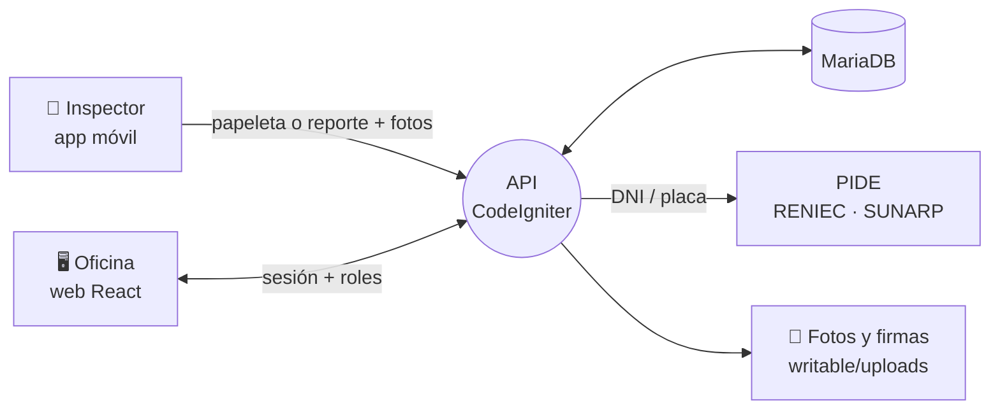
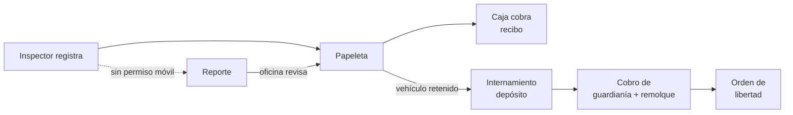

# Sistema de Gestión de Tránsito Municipal — MDJLO

Plataforma para fiscalizar, registrar y cobrar el tránsito y transporte de la **Municipalidad Distrital de José Leonardo Ortiz** (Chiclayo, Perú). Una web para la oficina y una app móvil para los inspectores en campo.


---

## Cómo funciona



**Flujo de una infracción**



## Módulos

| Módulo | Qué hace |
| :--- | :--- |
| **Padrón** | Personas, vehículos, asociaciones, trabajadores; consulta RENIEC y SUNARP |
| **Fiscalización** | Operativos, papeletas, reportes de intervención, fotos y firma |
| **Caja** | Pagos, recibos, arqueo diario, tarifas del depósito |
| **Depósito** | Internamientos, inventario del vehículo, órdenes de libertad |
| **Trámites** | Documentos (SOAT, TUC), permisos, inspecciones CERTICAV, cursos de seguridad vial |
| **Administración** | Usuarios y roles, auditoría, configuración municipal, dashboard |

## Roles

| Rol | Acceso |
| :--- | :--- |
| `SUPERADMIN` · `GERENTE` · `SUBGERENTE` | Todo, incluido borrar, anular y rebajar cobros |
| `SECRETARIA` | Oficina: registra y cobra, no borra ni anula |
| `TRABAJADOR` | Inspector: solo la app móvil (sus papeletas y reportes) |

---

## Puesta en marcha

Requisitos: [Docker Desktop](https://www.docker.com/products/docker-desktop/) y Git.

```bash
cp .env.example .env        # completa las claves; no subas el .env
docker compose up -d
docker exec mjlo_backend php spark migrate
docker exec mjlo_backend php spark db:seed UsuariosSeeder
```

> Guarda `encryption.key` en un lugar seguro: sin ella no se descifran los datos cifrados (token PIDE).
> Las credenciales iniciales están en `backend/app/Database/Seeds/UsuariosSeeder.php`; cámbialas al primer ingreso.

| Servicio | URL |
| :--- | :--- |
| Web | http://localhost:5173 |
| API | http://localhost:8080/api/status |
| phpMyAdmin | http://localhost:8081 (solo desde tu PC) |
| MariaDB | `localhost:3307` (solo desde tu PC) |

Reiniciar la base desde cero: `docker compose down -v && docker compose up -d`.

## Desarrollo

```bash
cd frontend && npm install && npm run dev          # web
cd backend  && composer install && php spark serve --port 8080
docker exec mjlo_backend vendor/bin/phpunit        # pruebas del backend
cd frontend && npx vitest run                      # pruebas del frontend
```

**App móvil:** pon la IP de tu PC en `MOBILE_API_URL` del `.env` y ejecuta `mobile/run-dev.ps1` (Windows) o `mobile/run-dev.sh`. Sin esa variable usa `10.0.2.2` (emulador Android).

## Notas

- Los registros llevan un `uuid` público (v7) además del `id`; el QR del vehículo es ese `uuid`. Todo insert nuevo debe usar `Identificador::nuevo()`.
- Estados de cursos, documentos y permisos se actualizan solos; puedes programar `php spark cursos:sincronizar-estados` una vez al día.
- El editor de permisos es **TinyMCE 8 autohospedado** (`frontend/public/tinymce`, licencia GPL v2+): no usa claves ni servicios externos. Para actualizarlo, reemplaza esa carpeta con la nueva versión y conserva `langs/es.js`.
- Las migraciones están en `backend/app/Database/Migrations/`; `init-db/transitomunicipal.sql` trae el esquema completo.

---

## Licencia

Desarrollado para la **Subgerencia de Tránsito y Transporte** — *Municipalidad Distrital de José Leonardo Ortiz*. Todos los derechos reservados.

---

## Equipo de desarrollo

| | Rol | Nombre | Contacto |
| :---: | :--- | :--- | :--- |
| 💻 |  |  | [](https://www.linkedin.com/in/jose-manuel-carrasco-millan-0a2b91323/) |
| 📱 |  |  | [](https://www.linkedin.com/in/juan-angelo-jhosep-saavedra-benavides-b97890387/) |
